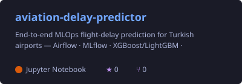
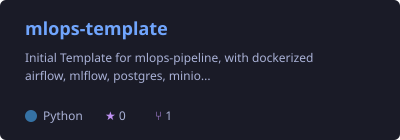
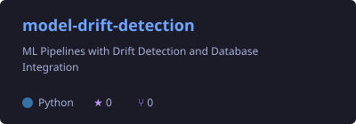

<!-- Header -->

  

  

  
  

---

### 👨‍💻 About Me

- 🔭 Building **production-grade ML pipelines**, from data ingestion to model serving
- ⚙️ Currently developing **industrial software** at my own company, **Hydra Machinery**: machine control systems & ERP
- ✈️ Side project: **[aviation-delay-predictor](https://github.com/devOzdemir/aviation-delay-predictor)**, flight-delay prediction on a 5.9M-row live dataset
- 🤖 Exploring **reinforcement learning** and **LLM applications**
- 🌱 Always learning: MLOps, cloud infrastructure, model monitoring & drift detection

---

### 🛠️ Tech Stack

  

  
  
  
  
  
  
  
  

---

### 📊 GitHub Stats

  
  

  

---

### 🚀 Featured Projects

  
  
  
  

---

### 🐍 Contribution Snake

  <picture>
    <source media="(prefers-color-scheme: dark)" srcset="https://raw.githubusercontent.com/devOzdemir/devOzdemir/output/github-snake-dark.svg" />
    <source media="(prefers-color-scheme: light)" srcset="https://raw.githubusercontent.com/devOzdemir/devOzdemir/output/github-snake.svg" />
    
  </picture>

  

